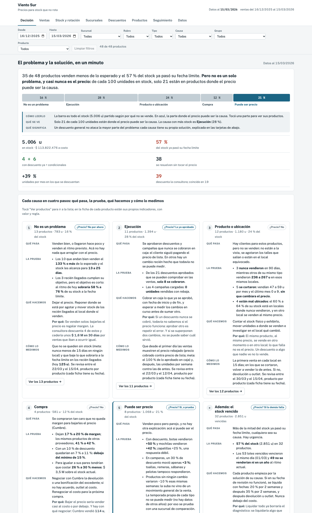
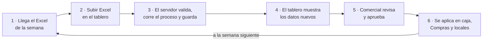
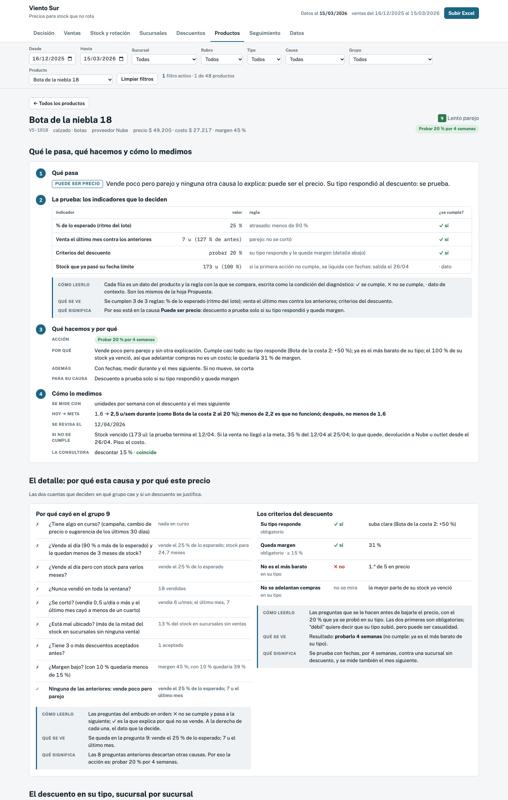
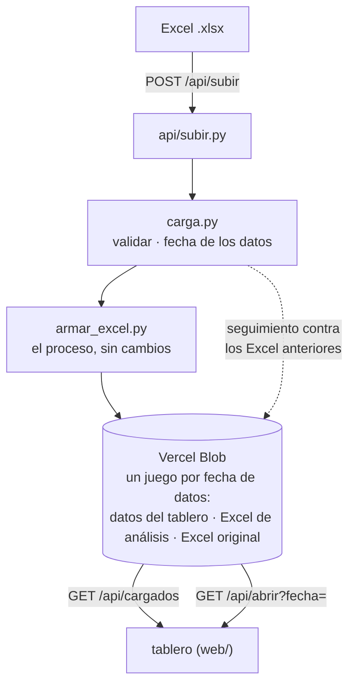
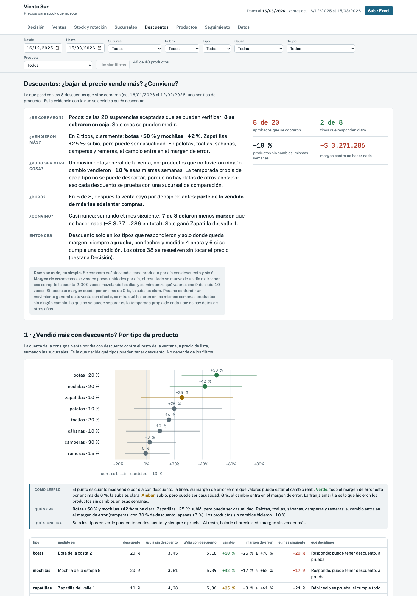
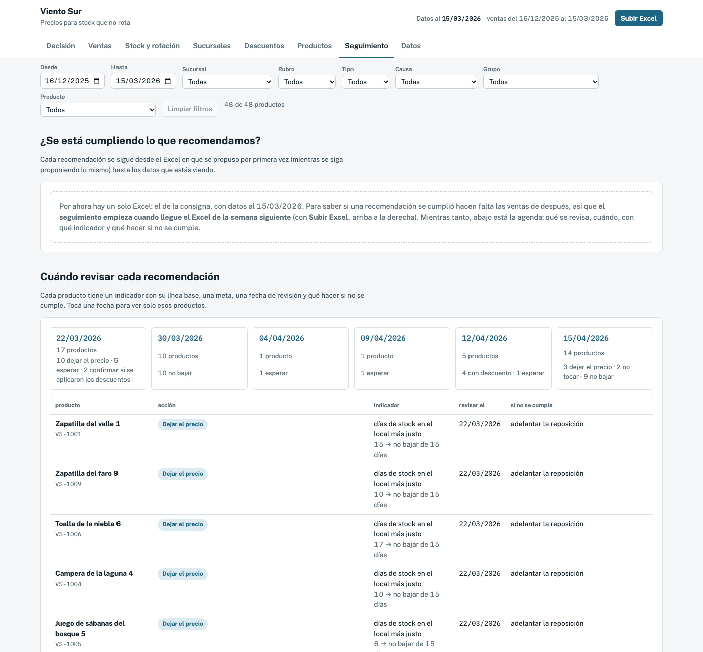

# Viento Sur · Precios para stock que no rota

Resolución de la prueba técnica. Con los datos al 15/03/2026, propone qué hacer con el precio de cada uno de los 48 productos y por qué, juzga el algoritmo de la consultora y arma un tablero para seguir la decisión semana a semana.

**Tablero online: [viento-sur-tablero.vercel.app](https://viento-sur-tablero.vercel.app)**. Muestra el Excel de la consigna (datos al 15/03/2026). Cada Excel nuevo se carga **desde el mismo tablero**, con el botón **Subir Excel**: el proceso corre en el servidor y el tablero pasa a mostrar la propuesta nueva y a medir si se cumplió la anterior. Abajo está [el paso a paso](#cómo-es-el-proceso-paso-a-paso).



## Dónde está cada respuesta

| La consigna pide | Está en |
|---|---|
| **El proceso** (pregunta 1) | [`armar_excel.py`](armar_excel.py): lee el Excel y genera todo lo de `salidas/` |
| **El archivo con la propuesta** | [`salidas/ventas_y_stock.xlsx`](salidas/ventas_y_stock.xlsx), hoja **Propuesta**: acción, motivo, meta y fecha de revisión de los 48 productos |
| **La nota** (qué miré, qué dejé afuera, efecto a 30 días) | [`salidas/nota.md`](salidas/nota.md) (también en la hoja **Nota** del Excel) |
| **Las 5 causas, en cuatro pasos** (qué pasa, la prueba, qué hacemos, cómo lo medimos) | [`salidas/causas.md`](salidas/causas.md) y la primera pantalla del tablero |
| **El juicio sobre la consultora** | En la nota, sección "Juicio sobre la consultora" |
| **El tablero** (pregunta 2) | [viento-sur-tablero.vercel.app](https://viento-sur-tablero.vercel.app), o [`web/index.html`](web/index.html) con doble clic |
| **El proceso alrededor del modelo** (pregunta 3) | [`proceso.md`](proceso.md) |
| **Herramientas de IA** | En la nota, sección "Herramientas de IA" |

## La respuesta en corto

**El problema:** hay 5.006 u en stock, 35 de 48 productos venden menos de lo esperado y el 57 % del stock ya pasó su fecha límite. Pero no es un solo problema, y el precio explica una parte chica.

| Por qué no se vende | Productos | Stock | Qué proponemos | ¿Toca el precio? |
|---|---|---|---|---|
| **No es un problema**: vende bien o recién llegó | 13 | 783 u | Dejar el precio; reponer, mover stock y medir cuánto sobraría | No por ahora |
| **Ejecución**: lo aprobado no llegó a caja, o hay un cambio en curso | 11 | 1.394 u | Que lo aprobado se cobre en caja, con fechas, y medirlo | Lo ya aprobado |
| **Producto o ubicación**: nunca vendió, se cortó o está en el local equivocado | 12 | 1.180 u | Contar el stock, exhibir, mover o investigar en el local | No |
| **Compra**: tan caro que no hay margen para descontar (Cumbre) | 4 | 581 u | Negociar devolución o bonificación con el proveedor | No |
| **Puede ser precio**: vende poco pero parejo, sin otra explicación | 8 | 1.068 u | Descuento a prueba solo si su tipo respondió y queda margen | Sí, a prueba |

- **El mensaje central:** solo el 21 % del stock está en productos donde el precio puede ser la causa, y aun ahí el descuento pasa los criterios en 3 de 8. En total: 4 descuentos ahora (a prueba, con fechas y medidos) y 6 si se cumple una condición; los otros 38 se resuelven sin tocar el precio.
- **Cada decisión se puede revisar**: la ficha de cada producto (y la hoja Propuesta) muestra su causa, el problema en una frase y los indicadores que lo deciden, con su valor, su regla y si se cumple.
- **El stock vencido tiene fecha de salida**: cada producto arranca por la acción de su causa. Si no cumple, los 8 cuyo tipo respondió al descuento se liquidan con fechas (20 %, después 35 %, después devolución u outlet) y los otros 24 van directo a devolución u outlet, porque ahí una rebaja regala margen sin sacar el stock. Siempre con piso en el costo. Última salida: 12/06/2026.
- **La consultora: tomaría solo una parte.** Descuenta 39 de 48 productos, en 12 proyecta vender más de lo que hay en stock y en 4 vende bajo costo. Sus proyecciones suben la venta entre +25 % y +50 % sin importar el tipo ni el porcentaje, aunque en varios tipos el descuento no movió la venta.
- **Hallazgo de proceso:** de las 20 sugerencias aceptadas que se pueden verificar en las ventas, solo 8 llegaron al precio cobrado.

Cada causa está contada en cuatro pasos con sus datos en [`salidas/causas.md`](salidas/causas.md); la nota lo resume en una tabla.

## Cómo es el proceso, paso a paso

El ciclo es semanal: llega el Excel, se sube al tablero, el gerente comercial revisa y aprueba, se aplica en los locales y, con el Excel de la semana siguiente, el tablero mide si se cumplió. Quién hace cada cosa y con qué reglas está en [`proceso.md`](proceso.md).



### 1. Llega el Excel de la semana

Tiene que tener **la misma forma que el de la consigna**: un `.xlsx` de hasta 4 MB con estas 8 hojas y columnas (puede tener otras hojas o columnas de más; se ignoran).

| Hoja | Columnas que se usan |
|---|---|
| `productos` | sku, nombre, rubro, tipo, proveedor, precio_lista, costo_unitario |
| `sucursales` | sucursal_id, nombre, ciudad, tipo |
| `stock_sucursal` | sku, sucursal_id, unidades, fecha_ingreso, fecha_limite, unidades_objetivo |
| `ventas` | fecha, sku, sucursal_id, unidades, precio_unitario |
| `historial_sugerencias` | sku, fecha_sugerencia, descuento_pct, aceptacion, fecha_vigencia_desde, fecha_vigencia_hasta |
| `cambios_precio` | sku, fecha, precio_anterior, precio_nuevo, origen |
| `campanas_activas` | sku, tipo_campana, fecha_desde, fecha_hasta |
| `propuesta_consultora` | sku, decision, descuento_pct, unidades_proyectadas_30d |

La **fecha de los datos** es el último día con ventas. Es la que se ve arriba a la derecha ("Datos al …") y la que identifica al Excel en la base.

### 2. Se sube en el tablero

1. Abrir [viento-sur-tablero.vercel.app](https://viento-sur-tablero.vercel.app).
2. Tocar **Subir Excel**, arriba a la derecha.
3. Elegir el archivo y tocar **Subir y procesar**. Tarda entre 15 y 40 segundos; mientras tanto se ve un contador.
4. Al terminar dice qué se cargó (por ejemplo, *"Listo: la base tiene los datos al 22/03/2026 (2 Excel en total)"*), cuántas recomendaciones anteriores pasa a medir el seguimiento, y el botón cambia a **Ver los datos al …**.

No hace falta instalar nada ni tocar el código: el mismo proceso que generó la entrega corre en el servidor.

### 3. Qué hace el servidor (solo, sin intervención)

| Paso | Qué pasa | Dónde está el código |
|---|---|---|
| **Valida** | Que estén las 8 hojas y sus columnas, que productos, stock y ventas no estén vacías, que las fechas y los números se entiendan y que todo el stock sea de productos del catálogo. Si algo falla, **no se guarda nada** y muestra la lista de problemas en palabras (por ejemplo, *"En la hoja «ventas» faltan las columnas: precio_unitario"*). | [`carga.py`](carga.py) → `validar()` |
| **Corre el proceso** | [`armar_excel.py`](armar_excel.py), sin cambios: el Excel de análisis, la propuesta de los 48 productos, la nota y los datos del tablero. | `carga.py` → `correr_proceso()` |
| **Guarda en la base** | En el almacenamiento de Vercel (Vercel Blob), con la fecha de los datos: el Excel original, el Excel de análisis y los datos del tablero. Si ya había un Excel de esa fecha, **lo reemplaza**; si es de una fecha anterior a otros ya cargados, los posteriores recalculan su seguimiento. Nada se pisa: cada cambio es una versión nueva. | [`servidor.py`](servidor.py) → `procesar_subida()` |
| **Mide el seguimiento** | Toma las recomendaciones de los Excel anteriores y las compara con las ventas nuevas (ver el paso 5). | `carga.py` → `seguimiento()` |

### 4. El tablero muestra los datos nuevos, para todos

Si son los datos más nuevos, cualquiera que abra el link ve la propuesta nueva. Los anteriores siguen en la base: se eligen en el selector **Datos al** (aparece cuando hay más de un Excel) o con un link directo, `viento-sur-tablero.vercel.app/?datos=AAAA-MM-DD`. Desde el pie de página se descarga el Excel de análisis completo de esa fecha.

### 5. Comercial revisa y aprueba

En este orden, unos minutos por semana:

1. **Decisión**: el problema y la solución en un minuto. El stock repartido en las 5 causas, una tarjeta por causa (qué pasa, la prueba, qué hacemos y por qué, cómo lo medimos) y la comparación con la consultora.
2. **Seguimiento**: qué pasó con lo que se recomendó antes. Cada recomendación tiene una **regla que se comprueba con las ventas**, según lo que se propuso:

   Es la misma meta que muestra la ficha del producto.

   | Se recomendó | Se cumple si |
   |---|---|
   | Un descuento | Se cobra en caja y vende al menos su meta de unidades por semana |
   | Cobrar una rebaja ya aprobada o confirmar una campaña | La rebaja se ve en el precio cobrado |
   | Dejar el precio (vende bien) | Sigue vendiendo al menos el 90 % de antes, sin quedarse sin stock |
   | Recién llegado: mover stock | Vende más rápido que antes (así baja lo que sobraría a la fecha límite) |
   | Esperar una suba de precio en curso | No vende menos del 90 % de antes |
   | Exhibir un producto que nunca vendió | Tiene al menos una venta |
   | Investigar un corte | Vuelve a vender lo de antes (sus unidades por semana) |
   | Revisar la exhibición en los locales donde no vende | Primeras ventas en esos locales |
   | Devolución, outlet, negociar con el proveedor | Se confirma fuera de las ventas (lo carga quien lo gestiona) |

   El resumen separa las que **ya llegaron a su fecha de revisión** (ahí se decide: seguir, ajustar o pasar al paso siguiente) de las que **siguen en curso** (todavía es temprano para juzgarlas). Con un solo Excel, como ahora, la pestaña muestra la agenda: qué se revisa, cuándo, con qué indicador y qué hacer si no se cumple.
3. **Productos → la ficha**: para cualquier producto que genere dudas. Muestra los mismos cuatro pasos con sus propios indicadores (valor, regla y si se cumple), el ritmo del lote, el detalle de sus descuentos por sucursal y el historial de precio.



### 6. Se aplica en los locales

Lo aprobado se ejecuta según [`proceso.md`](proceso.md): cada descuento con **fechas de vigencia** y cargado en caja (el encargado del local confirma el primer día; sin esa confirmación no cuenta como aplicado), las devoluciones y bonificaciones las gestiona **Compras**, y los locales cuentan, exhiben o mueven el stock. A la semana siguiente se sube el Excel nuevo y el ciclo vuelve a empezar: el paso 5 ya muestra si se cumplió.

### Si algo sale mal

| Pasa esto | Qué hacer |
|---|---|
| *"El Excel no tiene la forma esperada"* con una lista | Corregir lo que dice la lista (hoja o columna faltante, fechas o números que no se entienden) y volver a subirlo. No se guardó nada. |
| *"El archivo pesa más de 4 MB"* | Es el límite de Vercel por pedido. Sacar hojas que el proceso no usa. |
| *"El proceso no pudo correr con este Excel"* | El Excel pasó la validación pero tiene algo raro adentro; el mensaje dice la última línea del error. |
| Se subió un Excel equivocado de la misma fecha | Subir el correcto: lo reemplaza. |
| Se subió un Excel que no tenía que estar | Borrarlo desde la computadora (no hay botón para borrar, a propósito): `python servidor.py borrar AAAA-MM-DD`. Los posteriores recalculan su seguimiento. |

Es una demo: no tiene login, y lo que se sube queda público.

## Cómo funciona por dentro



- **Una sola lógica para la computadora y el servidor.** [`carga.py`](carga.py) valida, corre el proceso, mide el seguimiento y arma el paquete que lee el tablero. Lo usan tanto [`servidor.py`](servidor.py) (la base online) como [`actualizar.py`](actualizar.py) (la base local, en SQLite): probado, las dos dan el mismo seguimiento.
- **Las recomendaciones de cada Excel dependen solo de ese Excel.** Lo que depende de los anteriores es el seguimiento y la historia; por eso, si se carga un Excel viejo, solo se recalculan esas dos cosas en los posteriores.
- **Ninguna cifra está escrita a mano.** Si cambian los datos, cambian la propuesta, la nota, las causas y el tablero. El proceso da siempre el mismo resultado con el mismo Excel (los márgenes de error usan una semilla fija).
- **Si la base no responde**, el tablero muestra los datos con los que se publicó (`web/datos.js`) y lo avisa.
- **Por qué archivos y no una base de datos.** Con un Excel por semana alcanza con guardar un juego de archivos por fecha. Si esto escala (muchos meses para consultar con SQL, usuarios con permisos por local, o que los locales carguen lo que aplicaron), el paso siguiente es una base Postgres (por ejemplo, Supabase) con las mismas tablas que ya usa la base local en SQLite.

| Archivo | Qué hace |
|---|---|
| [`api/subir.py`](api/subir.py) | `POST /api/subir`: recibe el Excel (hasta 4 MB), lo procesa y lo carga |
| [`api/cargados.py`](api/cargados.py) | `GET /api/cargados`: la lista de Excel cargados (fecha y link al original) |
| [`api/abrir.py`](api/abrir.py) | `GET /api/abrir?fecha=AAAA-MM-DD`: los datos del tablero de esa fecha (sin fecha, los más nuevos) |
| [`servidor.py`](servidor.py) | La base online: un Excel por fecha, versiones que nunca se pisan, recálculo de los posteriores |
| [`blob.py`](blob.py) | Cliente mínimo del almacenamiento de Vercel, sin dependencias |
| [`vercel.json`](vercel.json), [`.vercelignore`](.vercelignore) | Qué se publica (el tablero armado, las funciones y los módulos que importan) y cómo corren (región San Pablo, hasta 60 s) |

## Correrlo en la computadora

No hace falta para usar el tablero; sirve para revisar el proceso o trabajar sin internet. Necesita Python 3.11 o más nuevo (probado con 3.14).

```bash
python -m venv .venv
source .venv/bin/activate
pip install -r requirements.txt
```

En Windows, el segundo paso es `.venv\Scripts\activate`.

**Solo el proceso** (lo que pide la pregunta 1). Genera en `salidas/` el Excel con la propuesta, `nota.md`, `causas.md` y `tablero_datos.json`, en pocos segundos:

```bash
python armar_excel.py
```

Opciones: `--datos otro.xlsx --salidas otra_carpeta`.

**El proceso más la base local y el tablero.** Hace en la computadora lo mismo que *Subir Excel*: guarda los datos en `datos/viento_sur.db` (SQLite, con su fecha) y arma el tablero en `web/`, que se abre con doble clic:

```bash
python actualizar.py --datos datos/viento_sur.xlsx
```

**La base online desde la computadora.** Necesita el token del almacenamiento (`BLOB_READ_WRITE_TOKEN`) en `.env.local`, que no se sube a GitHub:

```bash
python servidor.py lista
```

Las otras órdenes son `python servidor.py subir <excel>` (igual que el botón) y `python servidor.py borrar AAAA-MM-DD`.

**Publicar el sitio** (después de cambiar el código del tablero o del servidor; para cargar datos no hace falta, se usa el botón):

```bash
vercel deploy --prod --yes
```

**Probar el seguimiento sin esperar una semana.** [`herramientas/recortar_excel.py`](herramientas/recortar_excel.py) arma, desde el mismo Excel, cómo se veían los datos en una fecha anterior (las ventas hasta ese día y el stock de entonces). Cargando el recorte y después el Excel completo se ve el seguimiento funcionando. Es solo para probar: la base online tiene únicamente el Excel de la consigna.

```bash
python herramientas/recortar_excel.py 2026-03-08
```

## El Excel de análisis

Es lo que genera el proceso: [`salidas/ventas_y_stock.xlsx`](salidas/ventas_y_stock.xlsx) para la consigna, y uno por cada Excel subido (se descarga desde el pie del tablero).

| Hoja | Qué tiene |
|---|---|
| **Propuesta** | Los 48 productos: causa, el problema en una frase, los indicadores que lo deciden, acción, motivo, meta, fecha de revisión y si coincide con la consultora. Arriba, el resumen por causa; al final, la evidencia por tipo y los escenarios de los descuentos |
| **Nota** | La nota de supuestos |
| **Resumen** | Las sucursales comparadas: ventas en unidades y pesos, stock, rotación, productos compartidos |
| **Descuentos** | Los descuentos que llegaron a caja: antes, durante y después, por sucursal, contra un control, y lo que dejó cada uno |
| **S01 … F01** | Cada sucursal: ventas en el tiempo por rubro y producto, stock, rotación |
| **Datos por lote** | Los indicadores de cada producto en cada sucursal (ritmo del lote, % vendido, días de stock…) |
| **Cómo se calcula** | Cada cuenta y cada regla, explicadas |

## El tablero

8 pestañas, y debajo de cada gráfico y cada tabla, cómo leerlo y qué implica:

| Pestaña | Para qué |
|---|---|
| **Decisión** | El problema y la solución en un minuto: el stock por causa, una tarjeta por causa y el juicio sobre la consultora |
| **Ventas** | Cómo vienen las ventas en el tiempo, por rubro, sucursal y producto |
| **Stock y rotación** | Cuánto stock hay, cuánto pasó su fecha límite y a qué ritmo rota cada lote |
| **Sucursales** | Las 6 sucursales comparadas (4 propias y 2 franquicias) |
| **Descuentos** | Si los descuentos anteriores funcionaron: por tipo de producto, por sucursal, contra un control y con su margen de error |
| **Productos** | La lista de los 48, con una ficha por producto |
| **Seguimiento** | Si se cumple lo que se recomendó (con un solo Excel, la agenda de revisión) |
| **Datos** | Las tablas del Excel (ventas, stock, propuesta, sugerencias, campañas…) filtradas, para auditar, y la descarga del Excel de análisis |

Los filtros (fechas, sucursal, rubro, tipo, causa, grupo, producto) aplican a todas las pestañas y quedan en el link. Cada gráfico tiene **Ver y auditar los datos** con las filas exactas que lo arman. Los gráficos usan Chart.js desde un CDN, así que necesita conexión a internet.

| Descuentos | Seguimiento |
|---|---|
|  |  |

## Auditoría

[`salidas/auditoria/`](salidas/auditoria/) verifica todo con un cálculo independiente, hecho directo desde el Excel original (sin pasar por `armar_excel.py`):

- **La planilla:** 1.031 chequeos (los 100 lotes indicador por indicador, cada sucursal y los productos de la Propuesta).
- **Las decisiones, los descuentos y el seguimiento:** cada causa, cada regla, cada cifra de los descuentos y cada regla de seguimiento recalculada.
- **El tablero:** 17 combinaciones de filtros en todas las pestañas (763 chequeos, en la computadora y en el sitio publicado) y los puntos de cada gráfico de ventas.

Todas dan sin diferencias. Cómo correrlas: [`salidas/auditoria/LEEME.md`](salidas/auditoria/LEEME.md).

## Estructura

```
armar_excel.py            el proceso: Excel → propuesta, nota, causas, Excel de análisis y datos del tablero
carga.py                  lo común a la base local y a la online: validar, correr el proceso, seguimiento, paquete
servidor.py, blob.py      la base online (Vercel Blob)
api/                      las funciones del servidor: subir, listar y abrir los Excel cargados
actualizar.py             la base local (SQLite) y el tablero en web/, desde la computadora
herramientas/             recortar_excel.py: recorta el Excel a una fecha anterior (solo para probar)
proceso.md                pregunta 3: el proceso alrededor del modelo
datos/viento_sur.xlsx     el Excel de la consigna
salidas/                  lo que genera armar_excel.py, más la auditoría
tablero/                  el código del tablero (HTML, CSS, JS)
web/                      el tablero armado, listo para abrir o publicar
docs/capturas/            las imágenes de este README
vercel.json, .vercelignore  la publicación en Vercel
```
